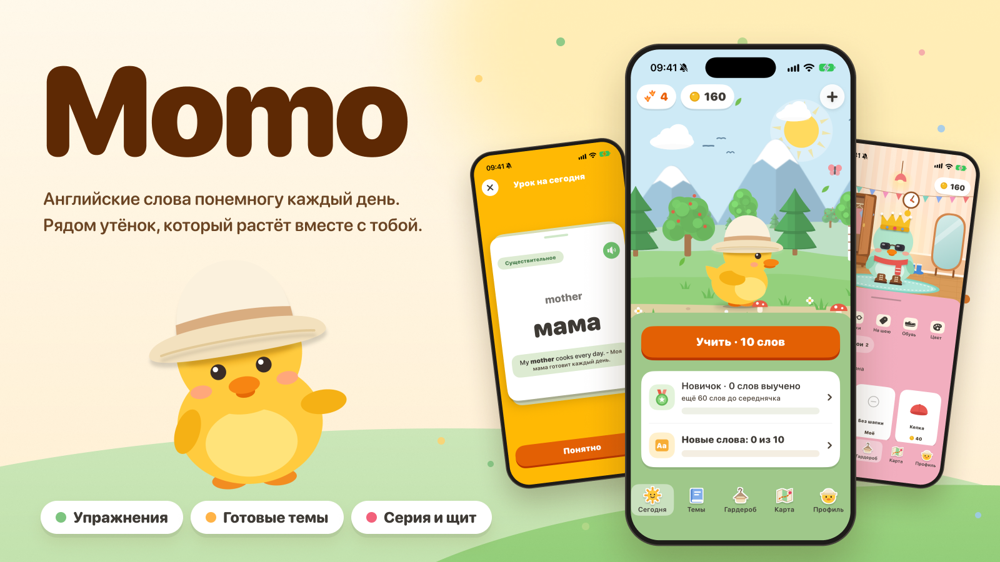

# 🐥 Momo

**Учи английские слова вместе с жёлтым утёнком Момо**

Маленькое iOS-приложение: короткий урок каждый день, живой утёнок и мир, который растёт вместе с твоим словарным запасом.

---

> Это витрина проекта: здесь только описание, без исходного кода.
> Приложение в разработке и пока не опубликовано в App Store.

## ✨ Что это

Momo помогает выучить английские слова без зубрёжки. Каждый день приложение собирает короткий урок:
слова, которые пора повторить, и несколько новых. Рядом всё время Момо: он гуляет по пейзажу, реагирует на твои ответы,
радуется успехам, растёт и носит вещи, которые ты ему покупаешь за заработанные монетки.

Идея простая: заниматься каждый день понемногу, и чтобы это было приятно.

## 🎯 Что умеет

- **Упражнения вместо «угадай сам».** Новое слово сначала показывают карточкой, потом проверяют: выбор перевода, обратный выбор, сборка слова из букв, аудирование. Вид упражнения зависит от того, насколько слово уже знакомо.
- **Интервальные повторения.** Слово возвращается через всё большие промежутки, пока не запомнится надолго.
- **Урок «Сегодня».** Повторения и новые слова в пределах дневной нормы, которую выбираешь сам.
- **Готовые темы.** Сотни слов уровней A1 и A2 и темы по жизни: от семьи и быта до путешествий и работы. Можно добавлять свои слова и темы.
- **Серия и щит.** Дни занятий подряд; за монетки можно купить щит, который прикроет пропущенный день.
- **Монетки и гардероб.** Монетки за верные ответы и пройденные уроки. На них Момо покупает шапки, очки, шарфы, обувь и новый цвет.
- **Рост Момо.** Шесть уровней, от Новичка до Легенды: чем больше слов выучено, тем взрослее Момо и тем дальше ведёт его карта мира.
- **Напоминания от Момо.** Несколько раз в день: утром, днём и вечером, каждый раз с новыми словами. Без давления: после пропусков становятся мягче и реже, а потом замолкают совсем.
- **Виджет.** Момо на экране телефона: серия, дорожка лапок по дням недели, настроение по времени суток.
- **Живая графика.** Утёнок, пейзажи со сменой времени суток и сезонов, жители дороги, появления Момо на заставке (яйцо, шарики, подарок, кораблик, мотоцикл), даже иконка приложения нарисованы кодом, без готовых картинок.

## 🧭 Принципы

- Простые честные награды: монетки платятся только за верные ответы.
- Никакой слежки, рекламы и обязательной регистрации. Данные остаются на устройстве.
- Приложение только на русском, только iPhone, только портретная ориентация.
- Уважение к вниманию: никаких давящих уведомлений и «ты потеряешь серию!».

## 🛠 Из чего сделано

SwiftUI и SwiftData, без сторонних библиотек и без собственного сервера. Все данные остаются на устройстве. Вся графика рисуется кодом.
Логика повторений отделена от интерфейса и покрыта автоматическими тестами.

## 📍 Статус

- ✅ Занятия, упражнения, повторения, темы, серия и щит, монетки, гардероб, рост Момо.
- ✅ Напоминания и виджет.
- 🚧 Карта приключений: рисуется, пока на её месте заглушка с говорящим Момо.
- 🔜 Публикация в App Store.

## 📄 Права

© Momo. Все права защищены. Название, персонаж Момо, рисунки, тексты и слова приложения нельзя копировать, изменять или использовать без письменного разрешения автора.
Исходный код закрыт и в этом репозитории не публикуется.
